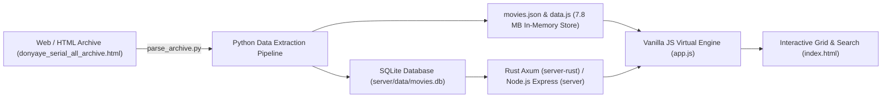

# Offline Persian Cinema & Series Catalog (آرشیو آفلاین فیلم و سریال) Blueprint

<div align="center">


**Zero-Dependency, Client-Side Search Engine & Archive Explorer for Persian Movies and Series.**

[English Documentation](#english-documentation) • [راهنمای جامع فارسی](#راهنمای-جامع-فارسی-persian-guide)

</div>

---

<a name="english-documentation"></a>
## System Overview

During nationwide or localized internet connectivity outages, accessing cloud-hosted streaming platforms or online movie databases becomes impossible. 

**Film_offline_Iran** is an offline-first single-page catalog application (SPA) and media streaming platform built to browse, search, and manage a massive indexed archive of movies and TV series with zero external internet dependencies. All dataset assets, metadata, media links, and Persian fonts are bundled locally, backed by high-performance Rust and Node.js backend services and an Android mobile client application.

### Key Features
- **Instant In-Memory Search**: Sub-millisecond debounced full-text search across thousands of indexed titles, Persian names, and English transliterations.
- **Multi-Faceted Filtering & Sorting**:
  - Filter by Media Type (Movies vs. TV Series).
  - Filter by Genre (Drama, Action, Sci-Fi, Crime, Animation, etc.).
  - Filter by Release Decade (1990s, 2000s, 2010s, 2020s+).
  - Sort by release date, alphabetical title, or catalog order.
- **Rich Media Modals & Playback**: Detailed modal views showcasing synopsis, season/episode tables, and direct stream/download links categorized by video quality (1080p, 720p, 480p, x265) powered by ArtPlayer.
- **Infinite Virtualized Grid**: Chunked lazy rendering (batch loading) ensuring butter-smooth 60 FPS scrolling even with massive datasets.
- **Adaptive Dark / Light Theme**: Built-in persistence via `localStorage`.
- **Python Data Extraction Pipeline**: Included parser (`parse_archive.py`) to scrape, clean, deduplicate, and convert HTML archives into compact, structured JSON and SQLite databases.

### Architecture & Data Pipeline



---

## Local Interface & Invariants

### Interface
- `[app.js:window.openPlayer]` Global function launching modal video player for a selected movie ID and source
- `[app.js:window.closeModal]` Global function dismissing open movie details modal
- `[app.js:window.openMovieById]` Global routing function opening movie modal by unique identifier
- `[app.js:window.showFavoritesModal]` Displays user favorites modal dialog
- `[app.js:window.closeFavoritesModal]` Hides user favorites modal dialog
- `[app.js:window.updatePageMeta]` Dynamically updates document title and SEO meta tags
- `[app.js:window.updateCurrentViewMeta]` Syncs social media graph tags with active view
- `[app.js:window.getShareUrl]` Generates canonical shareable URL with hash route
- `[app.js:window.openShareModal]` Opens movie sharing modal
- `[app.js:window.closeShareModal]` Closes movie sharing modal
- `[app.js:window.copyShareUrl]` Copies active share URL to clipboard
- `[app.js:window.shareMovie]` Triggers native navigator share API or fallback modal
- `[app.js:window.handleRoute]` Main hash-based URL routing handler
- `[app.js:window.showToast]` Non-blocking user feedback notification toast
- `[app.js:window.closeFilterDrawer]` Dismisses mobile filter drawer
- `[app.js:window.applyDrawerFilters]` Applies filter selections from mobile drawer
- `[parse_archive.py:GENRE_MAP]` Dictionary mapping IMDb identifiers to localized Persian genres
- `[parse_archive.py:TITLE_FA_MAP]` Dictionary mapping IMDb identifiers to verified Persian titles
- `[parse_archive.py:SYNOPSIS_FA]` Persian plot summaries dictionary
- `[parse_archive.py:parse_archive]` Ingests raw HTML archive and outputs structured records
- `[parse_archive.py:parse_votes]` Sanitizes and converts vote count strings to integers
- `[parse_archive.py:parse_rating]` Sanitizes and clamps IMDb rating values
- `[pwa-register.js:SADSAT_BUILD_VERSION]` Version constant (`2.2.0`) controlling cache purge and service worker lifecycle
- `[sw.js:CACHE_NAME]` Active CacheStorage version identifier (`sadsat-film-v2.2`)
- `[sw.js:STATIC_ASSETS]` Core application assets array precached on service worker installation
- `[package.json:scripts.server]` Starts Rust musl backend binary via `./server-rust/start.sh`
- `[package.json:scripts.server:rust]` Starts Rust backend server
- `[package.json:scripts.server:node]` Starts Node.js backend server via `node server/index.js`
- `[GET /api/home]` Consolidated single-flight catalog payload serving hero, spotlight, popular, series, and blockbuster movies with in-memory caching and stampede prevention
- `[POST /api/admin/cache/clear]` Localhost-restricted administrative endpoint purging in-memory catalog and search caches

### Invariants
- `[app.js:isApiAvailable]` Enabled only when `window.location.protocol !== 'file:'`
- `[app.js:API_URL]` Automatically selects `http://localhost:3001/api` during local frontend development or `/api` in production
- `[app.js:toggleFavorite]` Enforces user authentication; prompts login modal if no active session
- `[app.js:handleRoute]` Closes modal overlays and video player when routing away from `/movie/` or `/watch/`
- `[parse_archive.py:parse_rating]` Rating numbers clamped strictly to `[0.0, 10.0]`, falling back to `0.0` on invalid input
- `[parse_archive.py:parse_votes]` Sanitizes comma delimiters, falling back to `0` on format errors
- `[search:trigrams]` Multi-word search queries are tokenized into Boolean AND conjunctions of trigram terms (≥ 3 chars) on `movies_fts`, explicit quoted strings preserve phrase matching, and 1–2 character queries fall back to parameterized B-tree index prefix scans
- `[search:normalization]` Index-time (SQL triggers/backfill) and query-time normalization share an identical 87-character replacement pipeline unifying Persian/Arabic characters, digits, and stripping all harakat, Quranic marks, and ZWNJ
- `[cache:ttl]` In-memory catalog cache (`home`) enforces a 60-second TTL (max 5 items); search cache enforces a 30-second TTL (max 500 items)
- `[admin:security]` `POST /api/admin/cache/clear` strictly permits requests originating from loopback addresses (`127.0.0.1` / `::1`)
- `[pwa-register.js:SADSAT_BUILD_VERSION]` Service Worker registration activates only on `https:`, `localhost`, or `127.0.0.1`
- `[pwa-register.js:isReloading]` Guard flag prevents infinite reload loops on controllerchange
- `[sw.js:fetch]` Strictly intercepts HTTP GET requests; bypasses caching for video streams (`.mkv`, `.mp4`, `.webm`), HTTP Range requests, and `/api/` endpoints
- `[sw.js:fetch]` Applies cache-first caching to `/fonts/` and `/images/icon-*`, and network-first with cache fallback to all other resources
- `[package.json:type]` Configured as `commonjs`

### Side Effects
- `[app.js:handleAuthSubmit]` Stores `movieToken` and `movieUser` in browser `localStorage`
- `[app.js:logout]` Clears auth items from `localStorage`
- `[app.js:addToRecentlyViewed]` Updates `recentlyViewed` array in `localStorage` (maximum 10 entries)
- `[app.js:toggleTheme]` Sets `movie-archive-theme` in `localStorage` and updates `data-theme` attribute on document root
- `[app.js:openModal]` Mutates browser history state via `history.pushState` / `history.replaceState` and location hash
- `[app.js:loadArtplayer]` Injects `<script src="vendor/artplayer.js">` into `document.head` on demand
- `[app.js:loadOfflineScript]` Injects `<script src="data.js">` into `document.body` when API is unreachable
- `[app.js:applyFilters]` Dispatches asynchronous HTTP fetches to `/api/meta`, `/api/movies`, `/api/favorites`, and `/api/movies/recommendations`
- `[parse_archive.py:__main__]` Generates local filesystem files `movies.json` and `data.js`
- `[parse_archive.py:__main__]` Creates directory `server/data` and populates SQLite database `server/data/movies.db`
- `[server-rust:cache]` Allocates bounded in-memory cache entries via `moka`
- `[server-rust:fts_backfill]` Automatically triggers atomic startup backfill if `movies_fts_docsize` count does not match `movies` table count
- `[pwa-register.js:SADSAT_BUILD_VERSION]` Purges stale CacheStorage keys upon build version changes
- `[sw.js:install]` Caches static shell assets into CacheStorage
- `[sw.js:activate]` Claims clients and deletes outdated cache namespaces
- `[sw.js:fetch]` Stores HTTP 200 responses in CacheStorage

---

## Subdirectories & System Boundaries

- [Android Client](./android/README.md) - Native Android mobile client application built with Jetpack Compose, Room database, and Retrofit network client
- [Movie Streaming WebApp](./movie-streaming-webapp-master/README.md) - Reference client web application featuring Netflix UI sliders, video trailers, and client-side Trie autocomplete search
- [Rust Backend Server](./server-rust/README.md) - High-performance standalone Axum backend service compiled with musl, providing SQLite data endpoints, JWT auth, and static delivery
- [Node.js Backend Server](./server/README.md) - Express and SQLite backend service delivering authentication, user favorites management, and static file delivery
- [Vendor Libraries](./vendor/README.md) - Bundled third-party web libraries including ArtPlayer HTML5 video player and UI indicators

---

## Global Invariants

- Media streaming endpoints and video files (`.mkv`, `.mp4`, `.webm`) strictly bypass Service Worker cache storage and stream directly via HTTP range requests.
- The offline fallback dataset (`data.js` / `movies.json`) guarantees complete search and catalog navigation even when network connectivity or backend API servers are offline or under `file://` protocol execution.
- The SQLite catalog schema (`movies`, `users`, `favorites`) is shared between the Rust backend (`server-rust`) and Node.js backend (`server`).

## Global Side Effects

- Persistent SQLite database writes to `users` and `favorites` tables across backend implementations.
- Client browser state persistence within `localStorage` (`movieToken`, `movieUser`, `recentlyViewed`, `movie-archive-theme`).
- Network queries to `/api/*` and dynamic DOM manipulation for player mounting and infinite list scrolling.

## System Verification

- Run: `npm test`

---

## Quick Start

### Option 1: Direct File Launch (No Web Server Needed)
Simply open `index.html` in any modern web browser (Chrome, Firefox, Safari, Edge):
```bash
# Windows
start index.html

# macOS
open index.html

# Linux
xdg-open index.html
```

### Option 2: Local HTTP Server (Recommended)
```bash
# Using Python built-in server:
python -m http.server 8080
```
Then navigate to: `http://localhost:8080`

### Option 3: Backend Services
```bash
# High-performance Rust server
npm run server:rust

# Node.js server
npm run server:node
```

---

## Project Structure

```text
├── index.html                  # Main SPA entry point
├── app.js                      # Core reactive application logic & state machine
├── index.css                   # Responsive dark/light UI styling
├── data.js                     # Pre-compiled standalone JavaScript dataset
├── movies.json                 # Raw structured JSON catalog
├── parse_archive.py            # Python scraper & ETL data pipeline
├── android/                    # Android Jetpack Compose native application
├── movie-streaming-webapp-master/ # Netflix UI reference streaming app
├── server-rust/                # High-performance Axum Rust backend
├── server/                     # Node.js Express backend
├── vendor/                     # Artplayer & playback assets
├── fonts/                      # Embedded Persian typography
└── donyaye_serial_all_archive.html # Source raw archive snapshot
```

---

<a name="راهنمای-جامع-فارسی-persian-guide"></a>
## راهنمای جامع فارسی (Persian Guide)

این پروژه یک وب‌اپلیکیشن مستقل (Offline-First SPA) است که برای جستجو، کاوش و مرور آرشیو کامل فیلم‌ها و سریال‌ها با سرعت فوق‌العاده بالا طراحی شده است.

### ویژگی‌های اصلی
* **کاملاً آفلاین:** بدون نیاز به اینترنت، وب‌سرور خارجی یا پایگاه‌داده ابری؛ تمام داده‌ها به صورت کلاینت‌ساید (Client-side) لود و جستجو می‌شوند.
* **موتور جستجوی لحظه‌ای:** جستجوی فوق‌سریع در نام فارسی، عنوان انگلیسی و توضیحات با الگوریتم Debounce.
* **فیلترهای پیشرفته:** فیلتر براساس نوع اثر (فیلم/سریال)، ژانر، دهه تولید و نحوه مرتب‌سازی.
* **نمایش لینک‌های دانلود و کیفیت:** مدال اختصاصی نمایش فصل‌ها، قسمت‌ها و کیفیت‌های مختلف (1080p ،720p ،x265).
* **پایپ‌لاین داده پایتون:** اسکریپت `parse_archive.py` جهت استخراج، اعتبارسنجی و تبدیل صفحات آرشیو وب به فرمت استاندارد JSON و SQLite.

### نحوه اجرا
کافیست فایل `index.html` را در مرورگر خود باز کنید یا با دستور زیر یک وب‌سرور محلی سریع اجرا نمایید:
```bash
python -m http.server 8080
```
سپس آدرس `http://localhost:8080` را در مرورگر وارد کنید.

---

## License

This project is open-source under the **MIT License**.
